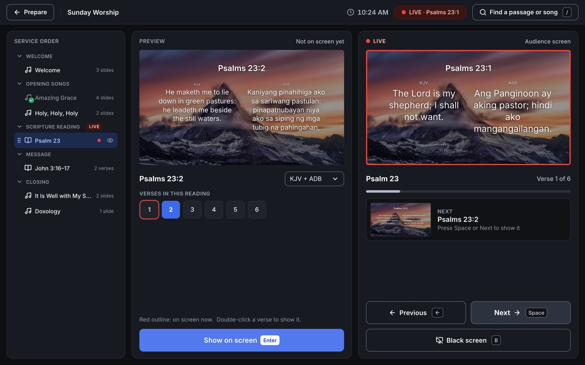
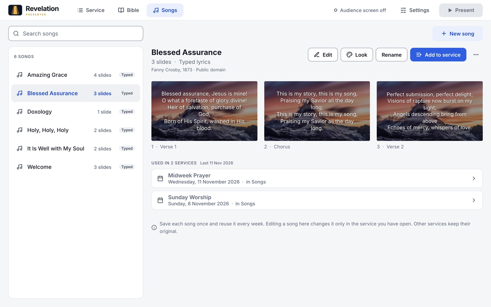

  

<h1 align="center">Revelation Presenter</h1>

  Songs, Bible passages and slides for church services on the Mac, 
  with a preview the congregation never sees.

  <a href="https://github.com/BnS2/revelation-presenter/releases/latest"><b>Download for Mac</b></a>
  &nbsp;·&nbsp; Apple Silicon &nbsp;·&nbsp; macOS 13 or later

## Highlights

- **Preview first, then show it.** Every slide waits in Preview until you press
  Enter. The audience only ever sees what you chose to send.
- **Two Bible versions side by side.** King James and Ang Dating Biblia install in
  one click, and any GetBible or Zefania file adds another.
- **Find a verse as it's announced.** Type `gen 1 4` or say "John 3:16" and it's
  ready in Preview, without touching the prepared service.
- **A songbook that remembers.** Save a song once and reuse it every week; each
  song lists the services that used it.
- **Bring what you already have.** PowerPoint, PDF (including Canva exports),
  photos, or lyrics typed straight in.
- **Free backgrounds.** A searchable library of CC0 pictures with credits, kept on
  the Mac for offline use.
- **Made for the keyboard and the clicker.** Space for next, B for a black screen,
  `/` to find anything.
- **Everything stays on your Mac.** No account, no subscription. One backup file
  moves the whole library to another Mac.
- **Updates itself.** When a new version is out, the app offers it, and installs it
  only when you say so.

## A closer look

### Plan the service

Name the groups yourself (opening songs, Scripture reading, announcements, and so on),
fill them from the library, and drag them into order. Clicking a slide only
previews it.

### Read in two languages at once

A reading can show one or two versions on the same slide, verse by verse, so the
reader and the congregation can follow along.

### Browse and save readings

Pick a book, a chapter and a range of verses, and save it as a reading for this
service or a later one.

### Keep one songbook

See every slide of a song at once, the songwriter's credit line, and the
services where you used it.

### Pick a background

Browse free CC0 backgrounds from Wikimedia Commons, download the ones you like,
and use them for every song or for one song.

Screenshots use public-domain hymns and Bible text (KJV, Ang Dating Biblia 1905)
and CC0 backgrounds.

## Install

Get the latest `.dmg` from
[Releases](https://github.com/BnS2/revelation-presenter/releases/latest).

The app isn't signed with an Apple Developer ID yet, so macOS asks for permission
the first time you open it:

1. Open the `.dmg` and drag Revelation into Applications.
2. Open Revelation. When macOS says it can't verify the developer, click **Done**.
3. Go to **System Settings > Privacy & Security**, scroll down to **Security** and
   click **Open Anyway** next to Revelation. Enter your Mac password.

From then on it opens like any other app.

## Songs

A new install starts with an empty songbook. To use songs another church has
shared, choose **Import a songbook** on the Songs screen or in
**Settings > Library**.

---

This repository only hosts the downloads. The app also checks here for updates.
